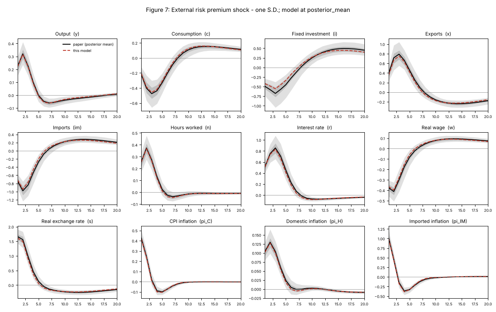

# Phase 1 report: the MOISE model in Python

Status: **draft, machine-checked, not yet verified by a person.** Every equation in
`model/moise.yaml` has `verified: false`, and every decision about a misprint has
`status: proposed`. This page summarizes what was built, how closely it reproduces the paper, and
what still needs a person's review.

## What was built

| Piece | Where | What it does |
|---|---|---|
| Model file | `model/moise.yaml` | All 120 Appendix D equations (212)–(331), each with the paper's code form (`printed`) and the form the solver uses (`expr`). 23 equations added from the main text (shock processes, the foreign real rate, observation errors). 143 variables, 46 innovations, 128 parameters, the Appendix C.2 steady state (63 steps), 35 documented decisions. |
| Solver | `src/moise/` | Generic: reads any model in this YAML format, builds the linear system, solves it with QZ (Blanchard–Kahn checks), computes impulse responses, simulations and variance decompositions. No MOISE-specific code. |
| Tests | `tests/` | 16 solver tests on models with known solutions; 15 checks of the YAML against `docs/paper` (every printed equation, every table value); 14 replication tests against Figures 6–18 and Tables 6–7. |
| Plots | `tools/replication/plot_irfs.py`, `figures/` | Model vs paper for all 13 impulse-response figures. |

The model has a unique stable solution at both the posterior mode and the posterior mean. The
structural block (98 equations) does not depend on the measurement block (45 equations), so
impulse responses can be computed without it.

## How closely it reproduces the paper

The paper's figures show the posterior **mean** of the impulse responses over parameter draws. The
closest single-parameter comparison is the model at the posterior-mean parameters (Tables 2–4).
Units, found by comparing with the figures: inflation panels are quarterly rates (×100), the
interest rate is annualized (×400), and the real-exchange-rate panel is ŝ of (217) (based on the GDP
deflator), not the CPI-based rate of (273).

### Impulse responses (Figures 6–18; 13 shocks × 12 panels × 20 quarters)

| | Posterior mean | Posterior mode |
|---|---:|---:|
| Panels with the same sign at the peak | 156 / 156 | 156 / 156 |
| Correlation with the paper's curve, median | 0.999 | 0.990 |
| Peak size relative to the paper, median (range) | 0.98 (0.72–1.19) | 1.00 (0.48–2.19) |
| Relative RMSE, median | 0.048 | 0.082 |
| Points inside the paper's 90% band | 99.9% of 3,120 | 91.1% |
| Points inside the paper's 70% band | 91.9% | 53.2% |

Relative RMSE is the RMSE divided by the largest absolute value of the paper's curve.

| Figure | Shock | Lowest / median correlation | Median peak size | Mean relative RMSE |
|---|---|---:|---:|---:|
| 6 | Interest rate | 0.992 / 0.999 | 0.80 | 0.081 |
| 7 | External risk premium | 0.998 / 0.999 | 0.97 | 0.030 |
| 8 | Symmetric premium | 0.916 / 0.998 | 0.96 | 0.070 |
| 9 | Foreign demand | 0.996 / 0.999 | 0.90 | 0.062 |
| 10 | Transitory technology | 0.975 / 0.998 | 1.05 | 0.041 |
| 11 | Domestic price markup | 0.995 / 0.999 | 1.06 | 0.031 |
| 12 | Import price markup | 0.994 / 1.000 | 1.02 | 0.018 |
| 13 | Oil price | 0.990 / 0.999 | 1.01 | 0.022 |
| 14 | Investment technology | 0.658 / 0.987 | 0.86 | 0.155 |
| 15 | Export share | 0.992 / 0.997 | 0.98 | 0.058 |
| 16 | Home bias | 0.993 / 0.998 | 0.96 | 0.051 |
| 17 | Wage markup | 0.997 / 0.999 | 1.10 | 0.051 |
| 18 | Inventory investment | 0.992 / 0.997 | 0.96 | 0.058 |



All 13 figures: [6](figures/irf_fig06.png) · [7](figures/irf_fig07.png) · [8](figures/irf_fig08.png) ·
[9](figures/irf_fig09.png) · [10](figures/irf_fig10.png) · [11](figures/irf_fig11.png) ·
[12](figures/irf_fig12.png) · [13](figures/irf_fig13.png) · [14](figures/irf_fig14.png) ·
[15](figures/irf_fig15.png) · [16](figures/irf_fig16.png) · [17](figures/irf_fig17.png) ·
[18](figures/irf_fig18.png)

The two visible differences have explanations that do not involve the model's equations:

- **Figure 6 is about 0.8 times the paper in every panel**, with correlation ≥ 0.99. The
  interest-rate shock S.D. is printed as 0.002; Table 3 rounds to three decimals, and about 0.0025
  reproduces the figure.
- **Figure 14 decays a little faster than the paper.** ρ_I is poorly identified (mode 0.906, mean
  0.732, 90% interval 0.48–0.94). Averaging responses over draws gives more weight to long-lived
  responses than the response at the mean parameter does. The model stays inside the paper's 90%
  band throughout.

### Variance decomposition (Table 7; 10 variables × 25 shocks × 3 horizons)

At the posterior mean, the model's shares differ from Table 7 by 0.42 percentage points on average
(median 0.06, 95th percentile 1.85). The largest contributor is the same as in the table in all
30 variable-horizon columns. The largest gap is the long-run share of the domestic premium shock in
the interest rate (53% vs 75.5%).

The biggest gaps all involve four shocks whose S.D.s are printed as 0.001 or 0.002, where rounding
to three decimals is a large relative error (η^R, η^DRP, η^{*,fwd}, η^Π̄). As a sensitivity check only
(the YAML keeps the printed values), choosing them within their rounding intervals (0.00243,
0.00134, 0.0005 and 0.00071; each still prints as the published value) cuts the mean gap to 0.26 pp
and the maximum to 10.4 pp. It also brings the Figure 6 interest-rate impact from 0.62 to 0.76
(paper: 0.78).

### Moments of the observables (Table 6)

Table 6 reports, at the posterior mean, the median over simulated 72-quarter samples of the mean
and S.D. of 11 observables. This checks the measurement block (291)–(331), which the figures do not
use. In percent:

| Observable | Mean: model | Mean: Table 6 | S.D.: model, 72-quarter samples (population) | S.D.: Table 6 |
|---|---:|---:|---:|---:|
| ΔC | 0.42 | 0.42 | 1.88 (1.92) | 1.87 |
| ΔX | 1.22 | 1.21 | 4.29 (4.35) | 4.37 |
| ΔI | 0.43 | 0.43 | 3.58 (3.61) | 3.54 |
| ΔIM | 0.72 | 0.71 | 3.56 (3.55) | 3.59 |
| ΔY | 0.43 | 0.43 | 1.80 (1.81) | 1.80 |
| ΔP_C | 0.50 | 0.51 | 0.87 (0.91) | 0.88 |
| ΔS | 0.00 | 0.01 | 3.30 (3.29) | 3.33 |
| r^OB | 5.03 | 6.35 (90%: −2.15 to 12.89) | 2.74 (4.17) | 2.57 |
| ΔW | 0.75 | 0.75 | 1.81 (1.84) | 1.82 |
| ΔN | 0.18 | 0.17 | 2.51 (2.50) | 2.46 |
| s_CA | 0.00 | −0.02 | 4.12 (4.34) | 4.03 |

The model's sample S.D.s are medians over 300 simulated samples. The means confirm the
growth-rate conversions of D34 (including the assumed g_{ΔW}). The one gap, the mean of r^OB, sits
well inside the paper's very wide interval. That interval is wide because of the near-unit-root
domestic premium shock, and its median depends on where the simulations start, which the paper
does not say.

## Decisions that need your review

The paper has misprints (listed in `docs/paper/README.md`). Each one is handled by a decision in
`model/moise.yaml` that records what is printed, what the model uses, why, and any evidence. Where
the printed form still gives a model that solves, it can be switched back:
`moise.load(decisions={"D13": "printed"})`.

**Supported by the figures** (switching to the printed or main-text form clearly worsens the fit;
`tests/test_replication.py` checks this):

| Decision | What | Fit to Figures 6–18 (mean relative RMSE), adopted vs alternative |
|---|---|---|
| D05 | (282), (284): ĉ → ŝ in the export-value term | 0.056 vs 0.174 |
| D06 | (288): last term is the foreign cost-push shock | printed form is indeterminate |
| D07 | (290): keep Appendix D's sign on the oil-price change (not (93)'s) | 0.056 vs 0.082 |
| D09 | (265): keep the factor 0.25 (not (65)'s plain sum) | 0.056 vs 0.172 |
| D13 | (217): (1−γ_S) on expected inflation differential | 0.056 vs 0.078 |
| D18 | (280): government weight p_G g/(p_Y y) | 0.056 vs 0.118 |
| D32 | γ_{u,1} with g_z/β | printed value gives negative steady-state consumption |

**Based on derivations or the main text, with no visible effect on the figures:** D12 ((214)
investment FOC: ĝ_z terms and exponent; derived twice independently), D14 ((225) denominators),
D17 ((248) lagged export inflation), D08 ((262) horizon), D11 ((212) VAT numerator kept as
printed), D33 ((200) exponent).

**Readings of notation:** D01–D04 (hat/no-hat spellings; (273) defines the CPI real exchange rate
as a new variable), D15 (ν_E = ν_C), D16, D19 ((300) observes the domestic target), D20, D27, D28,
D29 (β* = β).

**Model closure, from Section 4.4.2** (which of the 25 shocks exist and how they are specified):
D21 (shock processes added from the main text), D22 (one home-bias process), D23–D26 (variables
and shocks fixed at zero; taxes other than VAT constant).

**Values the paper does not report** (marked `TODO` in the YAML): D26 (persistence of constant taxes;
no effect), D30 (i.i.d. excess trends, per Appendix B), D31 (observation errors AR(1)), D34
(g_{ΔW}), D35 (unreported S.D.s set to zero). These affect only the measurement block or shocks that
are switched off.

To accept or reject a decision, change its `status` to `accepted` or `rejected` and fill
`reviewed_by`. To verify an equation, compare `printed` and `expr` with the PDF page given and set
`verified: true` and `verified_by`. Then add a line to `docs/verification-log.md`.

## Not done yet

- **Human verification.** No equation is verified. Phase 1's definition of done requires it.
- **Measurement block against the data.** The observation equations (291)–(331) reproduce the
  model-implied moments of Table 6. Running them on the actual Israeli data (Kalman filter,
  likelihood) is Phase 3.
- **Posterior-mean responses.** The paper averages responses over posterior draws. Reproducing that
  exactly needs the posterior draws, which are not published. The comparison here uses the response
  at the posterior mean.

## Reproduce

```bash
pip install -e ".[dev]"
pytest -q                                   # all tests, about 30 seconds
python tools/replication/plot_irfs.py       # rewrites docs/phase1/figures/
python tools/replication/plot_irfs.py --decision D13=printed --out /tmp/d13   # see one decision's effect
```

```python
import moise
sol = moise.solve(moise.load(param_set="posterior_mean").linear_system())
irf = moise.impulse_response(sol, "eta_R", periods=20, variables=["y", "pi_C", "r", "s"])
```
